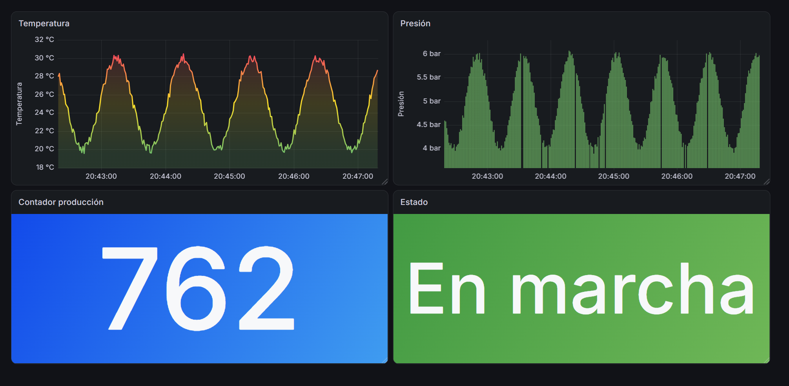
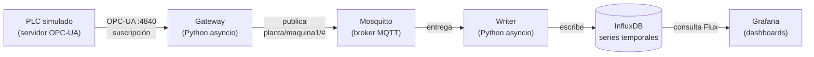

# Industrial Gateway

[](https://github.com/MarianoVera22/industrial-gateway/actions/workflows/ci.yml)
[](https://www.python.org/downloads/)
[](https://www.docker.com/)
[](https://github.com/astral-sh/ruff)

Gateway industrial que conecta un PLC con una plataforma de datos moderna.
Lee variables de proceso por **OPC-UA**, las publica por **MQTT**, las persiste en
**InfluxDB** y las visualiza en **Grafana**. Todo el stack de infraestructura corre
en contenedores y se levanta con un solo comando.



## El problema

En una planta, los datos de proceso viven encerrados en el PLC. Para analizarlos,
graficarlos o alimentar un MES hay que sacarlos de ahí, moverlos, y guardarlos en
algo que permita consultarlos por rango de tiempo.

Ese puente entre el mundo OT (operación) y el mundo IT (datos) es exactamente lo
que resuelve este proyecto: un gateway que habla el protocolo del PLC de un lado
y los protocolos de la nube del otro.

## Arquitectura



El **broker MQTT en el medio** es la decisión de diseño central: el gateway publica
sin saber quién escucha. Sumar un consumidor nuevo (alarmas, otro histórico, un
sistema externo) no requiere tocar una sola línea del gateway.

## Componentes

| Componente | Archivo | Rol |
|---|---|---|
| PLC simulado | `opcua_server.py` | Expone variables de proceso (temperatura, presión, estado, contador) que evolucionan con el tiempo |
| Gateway | `gateway.py` + `main.py` | Se suscribe a las variables del PLC y publica cada cambio en MQTT |
| Publisher | `mqtt_publisher.py` | Serializa los datos a JSON y los publica por topic |
| Writer | `influx_writer.py` | Consume MQTT y persiste cada punto en InfluxDB |
| Reintentos | `retry.py` | Backoff exponencial compartido por los servicios |
| Configuración | `config.py` | Carga de variables de entorno con defaults de desarrollo |

## Características

- **Suscripción OPC-UA** en vez de polling: el servidor notifica solo los cambios reales, sin tráfico inútil.
- **Reconexión automática con backoff exponencial** (1s → 2s → 4s … hasta 30s) en los tres puntos de red: OPC-UA, MQTT e InfluxDB. El sistema sobrevive a caídas de cualquier eslabón y se recupera solo.
- **Desacoplamiento vía cola**: el callback del PLC encola sin bloquear; una tarea aparte drena la cola hacia MQTT. Si el broker se pone lento, la lectura del PLC no se traba.
- **Tolerancia a datos malformados**: payloads inválidos, campos faltantes o valores no numéricos se registran y descartan sin tirar abajo el consumidor.
- **Timestamps de medición**: se persiste la hora en que el dato fue leído del PLC, no la hora de escritura, para mantener la correctitud temporal del histórico.
- **Stack completo en Docker Compose**: broker, base de datos y visualización en un comando.

## Stack técnico

**Python**: `asyncua` (OPC-UA), `aiomqtt` (MQTT), `influxdb-client`, `asyncio`
**Infraestructura**: Eclipse Mosquitto, InfluxDB 2, Grafana, Docker Compose
**Calidad**: `pytest` (36 tests), `mypy --strict`, `ruff`, GitHub Actions

## Puesta en marcha

Requiere Python 3.13+, [uv](https://docs.astral.sh/uv/) y Docker.

```bash
git clone https://github.com/MarianoVera22/industrial-gateway.git
cd industrial-gateway
uv sync

# Configuración (los defaults sirven para desarrollo local)
cp .env.example .env

# Levantar broker, base de datos y Grafana
docker compose up -d
```

Después, en tres terminales:

```bash
# 1 — PLC simulado
uv run python -m industrial_gateway.opcua_server

# 2 — Gateway: OPC-UA -> MQTT
uv run python -m industrial_gateway.main

# 3 — Writer: MQTT -> InfluxDB
uv run python -m industrial_gateway.influx_writer
```

### Interfaces

| Servicio | URL | Credenciales |
|---|---|---|
| Grafana | http://localhost:3000 | ver `.env` |
| InfluxDB | http://localhost:8086 | ver `.env` |

El dashboard de la captura está en `grafana/dashboard-maquina1.json`: se importa
desde **Dashboards → New → Import**.

## Variables monitoreadas

| Variable | Tipo | Simulación |
|---|---|---|
| `Temperatura` | REAL | Onda senoidal alrededor de 25 °C con ruido |
| `Presion` | REAL | Onda senoidal alrededor de 5 bar con ruido |
| `EnMarcha` | BOOL | 95% del tiempo en marcha (se persiste como 0/1) |
| `ContadorProduccion` | DINT | Incrementa mientras la máquina está en marcha |

## Desarrollo

```bash
uv run python -m pytest          # tests
uv run python -m mypy .          # verificación de tipos
uv run python -m ruff check .    # linting
uv run python -m ruff format .   # formateo
```

Los tests cubren la lógica pura (backoff, construcción de topics y payloads,
conversión a puntos de InfluxDB, validación de datos de entrada). El código de
red se ejercita con el stack real corriendo.

## Decisiones de diseño

**Suscripción sobre polling.** El sampling interval y el deadband de OPC-UA permiten
adaptar la suscripción a variables rápidas, sin el tráfico constante del sondeo.

**Cola entre productor y consumidor.** El handler de OPC-UA es sincrónico y la
publicación MQTT es asíncrona: una `asyncio.Queue` acotada los conecta y absorbe
diferencias de velocidad.

**Inversión de control en el gateway.** El gateway recibe una función `on_data` y
no decide qué se hace con los datos. Cambiar de "imprimir en consola" a "publicar
en MQTT" no requirió modificar el gateway.

**Configuración por entorno.** Credenciales y endpoints se leen de variables de
entorno con defaults de desarrollo, de modo que el proyecto arranque sin configurar
nada pero nunca lleve secretos al repositorio.

## Limitaciones conocidas

- Si InfluxDB está caído, los mensajes recibidos durante la indisponibilidad se registran pero se pierden. Un sistema de producción los bufferearía en disco para reenviarlos.
- La conexión OPC-UA usa modo de seguridad `None`. El protocolo soporta certificados X.509 y encriptación; aplicarlos es el siguiente paso de hardening.
- El tratamiento de errores de InfluxDB no distingue entre fallos transitorios (servicio caído) y de configuración (token inválido): ambos se reintentan.

## Licencia

MIT
